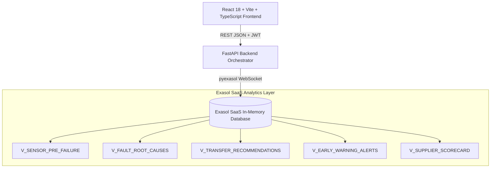

# LogiSense

> A maintenance and operations planner at a mid-size manufacturer cannot find why machines go down, where spare parts should be stocked, which quality defects to catch early, or how to compare suppliers who send data in different formats, because operational data is scattered and slow to analyse. If this worked, she would act before failures and shortages happen.

Built for **ExaThon India 2026** — *Factories, Fleets & Supply Chains Track*.

---

## 🚀 The 4 Intelligent Modules (Built on Exasol)

1. **Downtime Root Cause & Precursor Engine** (`/downtime`)
   - **Problem:** Machine breakdowns occur unexpectedly with unknown root causes.
   - **Exasol Solution:** Queries `V_SENSOR_PRE_FAILURE` and `V_FAULT_ROOT_CAUSES` to surface exponential vibration and temperature surges 6–48 hours prior to catastrophic mechanical seizure. Ranks root cause fault sequences (`E12 -> E31 -> E07`) with confidence metrics.

2. **Spare Parts Optimizer** (`/spare-parts`)
   - **Problem:** Critical parts stock out at one facility while sitting overstocked at another, tying up working capital.
   - **Exasol Solution:** Queries `V_INVENTORY_BALANCE` and `V_TRANSFER_RECOMMENDATIONS` to generate automated cross-facility rebalance directives, enabling one-click transactional transfers that avoid new purchase orders.

3. **Quality Watch (Early Defect Surveillance)** (`/quality`)
   - **Problem:** Quality defects are discovered late at end-of-line final inspection, wasting entire production batches.
   - **Exasol Solution:** Queries `V_EARLY_WARNING_ALERTS` and `V_QUALITY_TREND` using 7-day rolling window functions. Identifies early-stage in-process defect surges **3 to 5 days before** final assembly inspection failures.

4. **Universal Supplier Ingestion & Reliability Leaderboard** (`/suppliers`)
   - **Problem:** Suppliers submit messy CSV and XLSX files with conflicting headers, date formats, and currencies.
   - **Exasol Solution:** Features a drag-and-drop ingestion engine with `rapidfuzz` auto-mapping, date/number normalization into `SUPPLIER_DELIVERIES`, and recalculation of composite vendor reliability scores via `V_SUPPLIER_SCORECARD`.

---

## Demo video
https://drive.google.com/file/d/1eKLls4hGykX5P3WFEZgxOqG8uOQQWf2h/view?usp=sharing

---

## 🏛️ Architecture



All heavy aggregations, multi-day window functions, and ranking calculations execute **inside Exasol's in-memory columnar engine**, keeping the API layer lightweight and sub-second responsive.

---

## 🛠️ Prerequisites

- Python 3.11+
- Node.js 20+
- An active Exasol SaaS account with your public IP allowed on the cluster network list.

---

## ⚡ Quick Start

### 1. Configure Environment
Create a `.env` file in the project root:
```env
EXA_HOST=your-cluster.clusters.exasol.com
EXA_PORT=8563
EXA_USER=your_username
EXA_PASSWORD=your_pat_token
EXA_SCHEMA=LOGISENSE
JWT_SECRET_KEY=dev_secret_key_exathon_2026
```

### 2. Database Schema & Data Generation
```powershell
# Install backend dependencies
pip install -r backend/requirements.txt

# Create schema and views
python scripts/setup_db.py

# Generate and load deterministic synthetic data with planted patterns
python scripts/generate_data.py --size small
```

### 3. Launch Backend
```powershell
cd backend
uvicorn app.main:app --reload --port 8000
```
API Documentation will be live at `http://localhost:8000/docs`.

### 4. Launch Frontend
```powershell
cd frontend
npm install
npm run dev
```
Open **`http://localhost:5173`** in your browser.

---

## 🔑 Demo Credentials

Click any of the **one-click demo login buttons** on the sign-in screen:

| Role | Email | Password |
|---|---|---|
| **Admin** | `admin@logisense.dev` | `demo1234` |
| **Planner** | `planner@logisense.dev` | `demo1234` |
| **Warehouse** | `warehouse@logisense.dev` | `demo1234` |

---

## 🔒 Data & Third-Party Disclosure

- **100% Synthetic Data:** All operational, machine, and vendor records were generated deterministically by `scripts/generate_data.py` with reproducible random seeds. No real or proprietary data is used.
- **Third-Party Libraries:**
  - `Exasol SaaS` (In-memory columnar data platform)
  - `pyexasol` (MIT) — Exasol WebSocket driver
  - `FastAPI` / `Uvicorn` / `Pydantic` (MIT/BSD) — API backend
  - `bcrypt` / `python-jose` (MIT/Apache) — Authentication
  - `rapidfuzz` (MIT) — Fuzzy column mapping
  - `React` / `Vite` / `Tailwind CSS` (MIT) — User interface
  - `Recharts` (MIT) — Interactive telemetry charts

---

## 📄 License

MIT License © 2026 Ayaan — ExaThon India 2026
