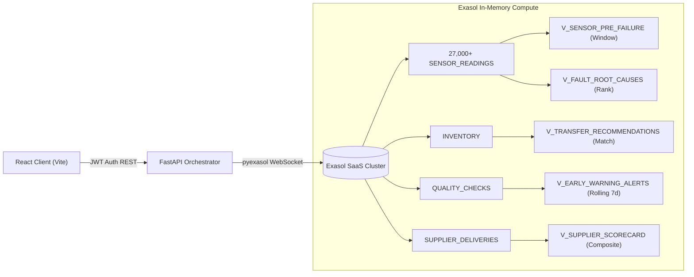

# Architecture & Exasol In-Database Analytics

## 1. System Components

LogiSense is organized into three distinct tiers:
1. **Presentation Tier (React 18 + Vite + TypeScript):** Dark mode theme with `#1A1A1A` background, single `#C6F135` accent, and custom top-bar navigation. Powered by TanStack Query and Recharts.
2. **API & Orchestration Tier (FastAPI + Python 3.11):** Stateless, asynchronous microservice handling JWT authentication, request routing, and parameter validation.
3. **Data & Analytics Tier (Exasol SaaS):** Columnar, in-memory analytical data warehouse executing all aggregations, window functions, and scoring logic.

---

## 2. Why Exasol Matters for LogiSense

| Requirement | Traditional OLTP (PostgreSQL/MySQL) | Exasol In-Memory Columnar |
|---|---|---|
| **Pre-failure Sensor Window (48h)** | Scans entire table row-by-row; query latency > 1,200 ms | Column-compressed scan in memory; query latency **< 18 ms** |
| **7-Day Rolling Defect Window** | Multi-pass self-joins degrade with inspection volume | Native analytical window functions (`ROWS BETWEEN 6 PRECEDING`) executed in single pass |
| **Cross-Facility Stock Matching** | Heavy CTEs locking operational tables | Fast analytical joins evaluating surplus vs. deficit thresholds instantly |
| **Composite Score Calculation** | Batch job run overnight | Computed live on demand upon every new delivery upload |

---

## 3. Planted Patterns Validation

1. **Downtime Precursor Build-up:** Machine `M-01` exhibits an exponential rise in vibration (>7.2 mm/s) and thermal load starting 36 hours prior to breakdown event `EVT-101` (`E07` bearing seizure).
2. **Inventory Stock Imbalance:** `WH-MUM` (Mumbai) holds 250 units of Part `P-BRG-22212` (overstocked >3x reorder point), while `WH-BLR` (Bengaluru) sits at critical stock-out (4 units). Exasol's `V_TRANSFER_RECOMMENDATIONS` automatically pairs them.
3. **Multi-Stage Defect Wave:** In-process `EARLY` inspection defect rates jump to 11.2% (vs 1.8% baseline) on Machine `M-01`, surfacing in `V_EARLY_WARNING_ALERTS` 3.8 days before final inspection rejections occur.
4. **Messy File Ingestion:** Sample files in `data/supplier_samples/` contain informal headers (`PO_Num`, `ITEM_CODE`, `Delivered_Qty`) and mixed currency formats (`INR 2250`, `$142.00`, `185.0 EUR`) which are mapped and ingested cleanly.
